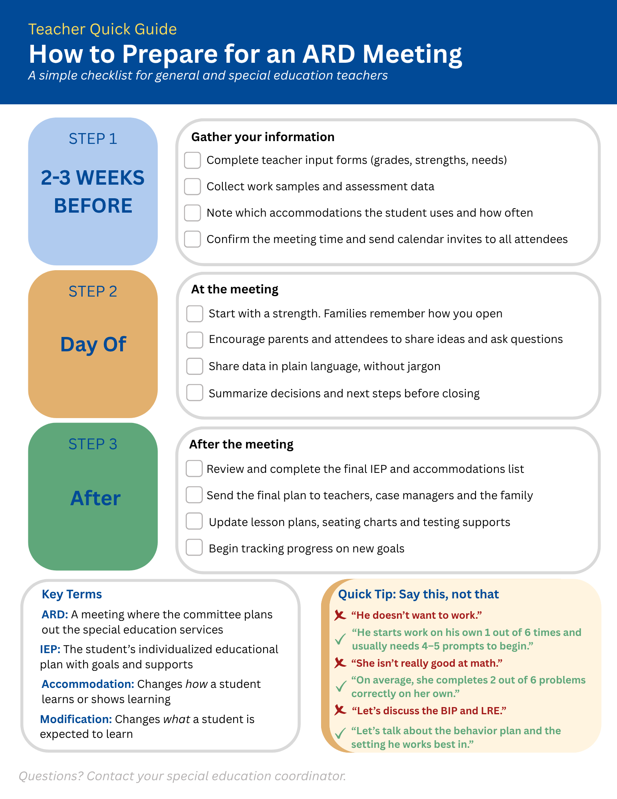

# Instructional Design Portfolio
**Yvette Saucedo, M.Ed.** | Special Education & Curriculum | [LinkedIn](https://www.linkedin.com/in/yvettesaucedo)

Learning resources I designed to help special education teams run smooth, family-centered ARD meetings. All examples are fictional and contain no student information.

## 1. Job Aid: How to Prepare for an ARD Meeting
A one-page checklist that walks teachers through what to do before, during, and after an ARD meeting, with key terms in plain language and "say this, not that" examples for talking with families.

**Tool:** Canva  
**Audience:** General and special education teachers  

[Download the PDF](Yvette_Saucedo_ARD_Meeting_Prep_Job_Aid.pdf)

## Coming soon
- Microlearning course in Articulate Rise 360: *Preparing for a Successful ARD Meeting*
- Short training video
